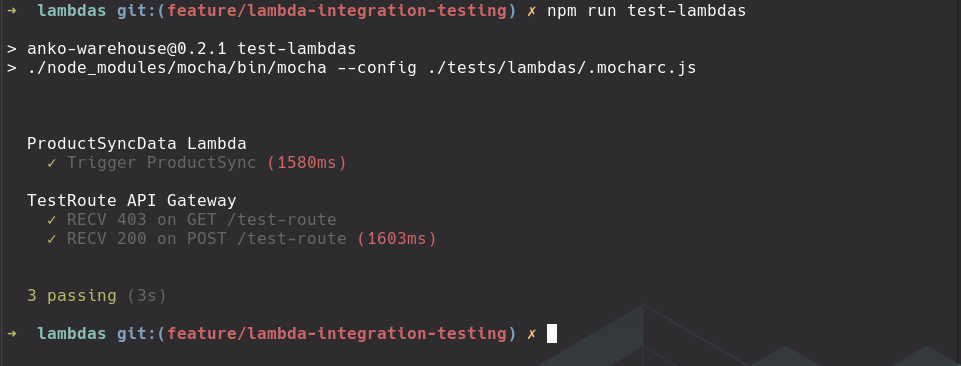

### Running unit / integration test locally against your lambdas

1. In your `anko_microservices` repository go to the lambdas directory and run `sam local start-api --config-file ./samconfig.toml -p 3002 --profile=<anko-kmart-profile-name>` This will start your api-gateway on port 3002.

2. Then in another terminal run `sam local start-lambda --config-file ./samconfig.toml --profile=<anko-kmart-profile-name>` This will start the lambda invoke endpoint at `127.0.0.1:3001`

3. Now go to `ankous` repository and do `npm i` to install the dependencies. Then run `npm run local` which will start the backend apis on port 3000

4. Then in your `ankous` repository run `npm run test-lambdas`

