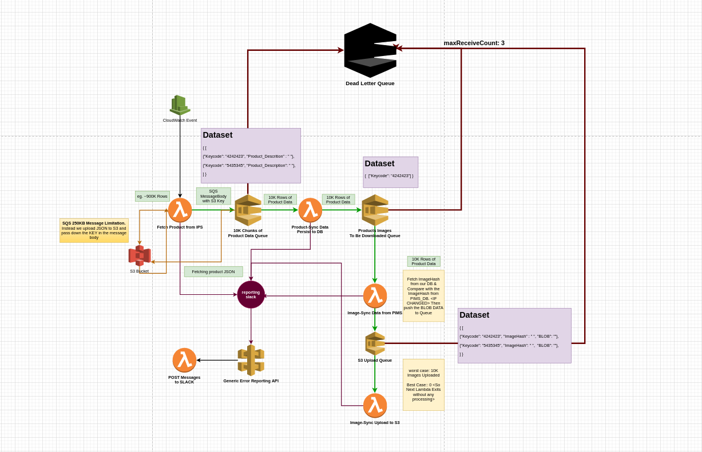

# Product & Image Sync Documentation

## Overview of Lambdas

###### FetchProductsFromIPS
``This lambda fetches all the products from the IPS db and chunks up the rows of data into 10K entries and upload them to the S3 Bucket. Then it pushes the s3 Key on to the Queue PersitProductsToDBQueue ``
###### PersistProductsToDBLambda
`This lambda gets triggered from the PersitProductsToDBQueue. It takes the S3 key from the event body and downloads the 10K rows of data (JSON on S3) and updates the product, product_attr and product_barcode table. Once the update is done, it pushes the same message it had received on to the queue FetchAndCompareImagesPIMSQueue  `
###### FetchAndCompareImagesPIMSLambda
`This lambda gets triggered by the FetchAndCompareImagesPIMSQueue and it downloads the JSON containting the 10K rows of data, filters out the keycodes and gets the SHA1 checksum from the PIMS DB. We take the SHA1 checksum that we receive from the PIMS_DB and compare it to our exising ImageHash and if the ImageHash has changed then we mark these keycodes for update. This list of [Keycodes: ImageHash] <= 10K is chunked into 1K blocks and pushes on to the next queue UploadImagesToS3Queue`
###### UploadImagesToS3Lambda
`This lambda gets triggered from the UploadImagesToS3Queue and it cosumes the the message body from the SQS which contains the Keycode and the new ImageHash. We fetch the blob image data associated with these keycodes from the PIMS_DB and upload them to S3. This lambda uploads images in batches of 1000s but the concurrency of this lambda has been set to 20, so this should speed up the upload process of 100K images, as it is often the case.`

